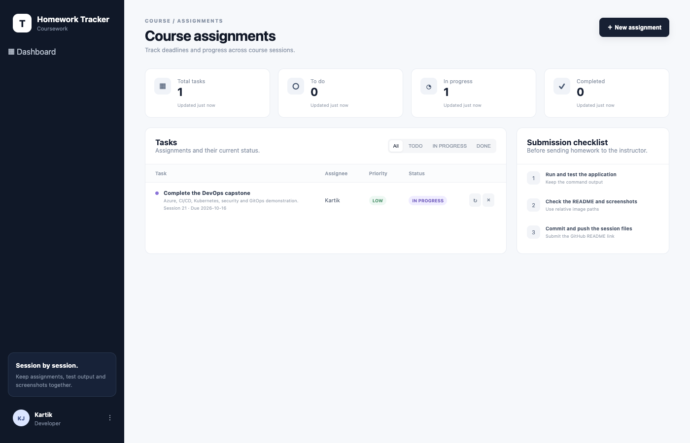
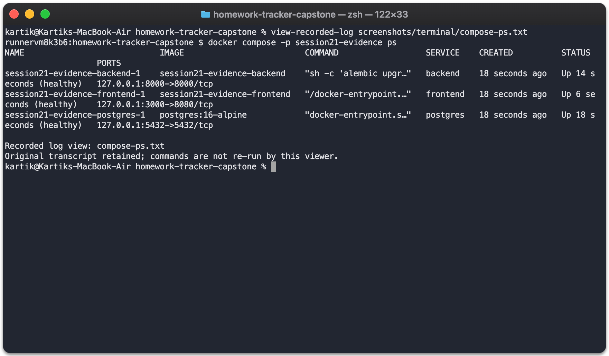

# Homework Tracker

[](https://github.com/karttikjangid/homework-tracker-capstone/actions/workflows/ci-cd.yml)

A course-assignment tracker built with React, FastAPI and PostgreSQL. Assignments have a session, deadline, assignee, priority and status. The project demonstrates container builds, security gates, infrastructure as code, Kubernetes delivery, monitoring and GitOps.

[Quick start](#quick-start) · [Deployment](docs/deployment.md) · [Verification](docs/verification.md) · [Walkthrough](docs/walkthrough.md) · [Release](https://github.com/karttikjangid/homework-tracker-capstone/releases/tag/v1.0.0)



## Architecture

```text
GitHub → Actions → Tests + security gates → GHCR
              └→ Kind: Helm, browser tests, HPA, Argo CD

Terraform → Azure VNet + NSG + VM → K3s
Approved GHCR images → Helm → Frontend + Backend + PostgreSQL
                                  ↓
                            Prometheus → Grafana

Browser → Ingress → React
              └── /api → FastAPI → PostgreSQL PVC
```

CI verifies deployments in an isolated Kind cluster. The Azure deployment uses one `Standard_B2als_v2` VM with K3s, restricted SSH and a private Kubernetes API accessed through an SSH tunnel. The cloud resources were destroyed after verification.

## Quick start

Requirements: Docker Engine and Compose v2. Run from the repository root:

```bash
docker compose up -d --build --wait
docker compose ps
curl -fsS http://localhost:8000/ready
```

| Service | Address |
| --- | --- |
| Frontend | [localhost:3000](http://localhost:3000) |
| API documentation | [localhost:8000/docs](http://localhost:8000/docs) |
| Backend readiness | [localhost:8000/ready](http://localhost:8000/ready) |

PostgreSQL persists in a named volume. Both application images run as non-root users, and the backend applies Alembic migrations before serving requests. The credentials in Compose and Helm are classroom demo defaults.

```bash
docker compose down       # Keep database data.
docker compose down -v    # Remove the demo database too.
```



## Repository layout

```text
.github/workflows/    CI/CD workflow
backend/              FastAPI application, Alembic migrations and tests
frontend/             React application and Nginx configuration
docs/                 Development, deployment, troubleshooting and verification
  course/             Instructor rubric and submission requirements
terraform/            Azure network and VM infrastructure
helm/taskboard/       Application chart and release values
k8s/                  Namespace and rendered application manifests
gitops/               Argo CD project and Application
monitoring/           Prometheus and Grafana configuration
security/             Security tooling dependencies
scripts/              Browser checks, load tests, recovery and capture tools
troubleshooting/      Deliberately broken resources for the recovery exercise
screenshots/          Current terminal evidence, CI reports and historical archive
docker-compose.yml    Local three-service stack
```

The Helm chart is the deployment source. `k8s/application.yaml` is a rendered snapshot; edit the chart to change the deployment. Course material and archived evidence are kept separately from application code.

## CI/CD and security

The [workflow](.github/workflows/ci-cd.yml) runs backend tests, frontend builds, Bandit, pip-audit, npm audit and Trivy secret scanning. It builds both Docker images, blocks HIGH/CRITICAL image findings, then publishes SHA-tagged images to GHCR. Kubernetes checks cover Ingress, browser interaction, migrations, HPA scaling, failure recovery, monitoring and GitOps self-healing.

Public images:

- `ghcr.io/karttikjangid/homework-tracker-backend`
- `ghcr.io/karttikjangid/homework-tracker-frontend`

The chart pins the approved application SHA `2b74cb7f4da3cbb2dccc8faaab52b23c68f46f98`. The [v1.0.0 release](https://github.com/karttikjangid/homework-tracker-capstone/releases/tag/v1.0.0) includes an offline image archive, checksums and the recorded walkthrough.

## Verification

[Successful pipeline](https://github.com/karttikjangid/homework-tracker-capstone/actions/runs/38812142701), verified 16 October 2026:

| Check | Result |
| --- | --- |
| API and migration tests | 11 passed |
| Build and security gates | Passed |
| Compose, frontend, APIs and PostgreSQL persistence | Passed |
| Kubernetes, Helm and HTTP Ingress | Passed |
| HPA under HTTP load | Backend scaled from 2 to 4 Pods |
| GitOps reconciliation | Synced/Healthy after self-healing |
| Monitoring | Prometheus target UP; Grafana populated |
| Azure cleanup | 9 resources destroyed; resource group absent |

[Full evidence and screenshots](docs/verification.md) · [Recorded walkthrough](docs/walkthrough.md) · [Troubleshooting](docs/troubleshooting.md)

## Presentation

[View slides (PDF)](https://github.com/karttikjangid/homework-tracker-capstone/releases/download/presentation-2026-10-22/homework-tracker-capstone.pdf) · [Download PowerPoint](https://github.com/karttikjangid/homework-tracker-capstone/releases/download/presentation-2026-10-22/homework-tracker-capstone.pptx)

The 16-slide presentation covers the application, CI/CD, security, Azure infrastructure, Kubernetes, monitoring and troubleshooting. The PowerPoint includes speaker notes. [Recorded demonstration](docs/walkthrough.md).

## Documentation

- [Development and API checks](docs/development.md): manual setup, tests and exact API commands.
- [Deployment and operations](docs/deployment.md): Terraform, Kubernetes, Helm, monitoring, GitOps, rollback and cleanup.
- [Azure connection instructions](terraform/README.md): variables, SSH access and kubeconfig handling.
- [Requirements mapping](docs/course/requirements.md) and [submission instructions](docs/course/submission.md).

## Project context

This capstone extends the instructor's [TaskBoard starter](https://github.com/Nency-Ravaliya/devops-heros/tree/main/session21-python) with assignment-specific fields, migrations, validation and browser error handling. It was developed with coding-assistant support.

Azure/K3s replaces the reference rubric's AWS/EKS architecture; instructor acceptance of this substitution is not recorded. The [requirements mapping](docs/course/requirements.md) records the difference.

The main lessons were to inspect raw test results, wait for database readiness, verify persistence through the browser and remove cloud resources after the demonstration.
