# Verification — 16 October 2026

[Successful standalone pipeline](https://github.com/karttikjangid/homework-tracker-capstone/actions/runs/38812142701), application image SHA `2b74cb7f4da3cbb2dccc8faaab52b23c68f46f98`. The chart defaults promote this release. Later commits contain documentation and evidence.

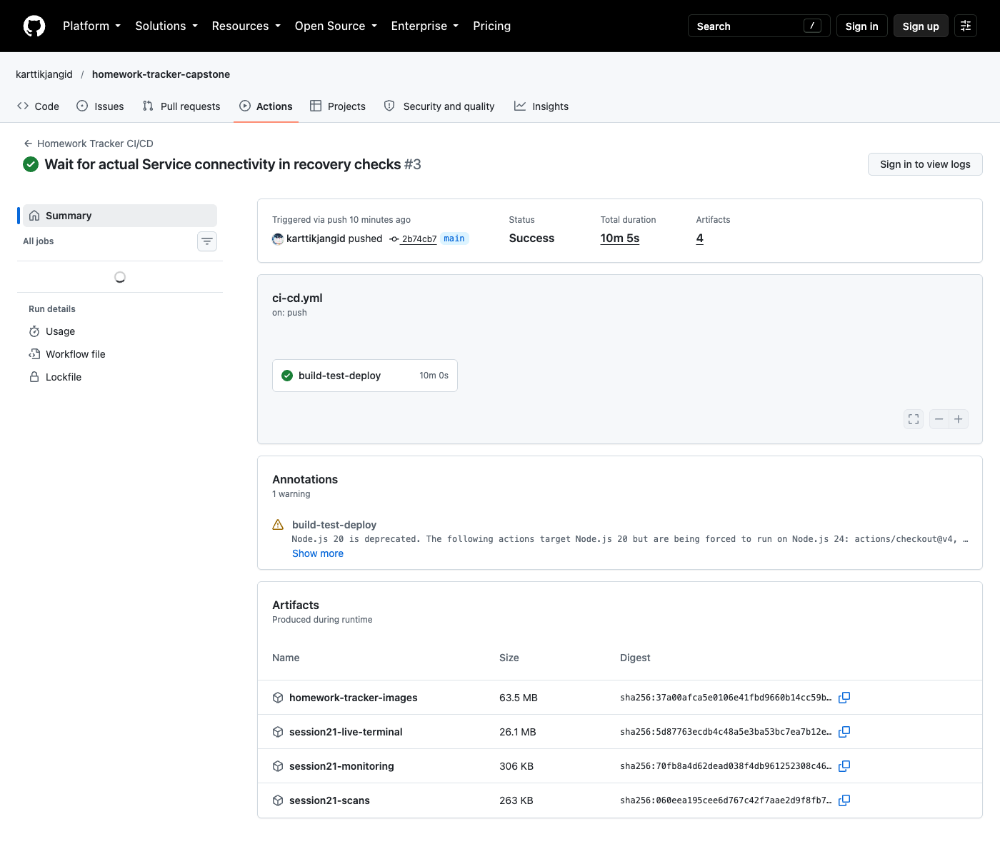

Eleven API/migration tests passed. SAST, dependency, secret and both image scans passed. [Test output](../screenshots/verification/standalone-review-tests.txt) · [Backend scan](../screenshots/verification/standalone-backend-scan.txt) · [Frontend scan](../screenshots/verification/standalone-frontend-scan.txt)

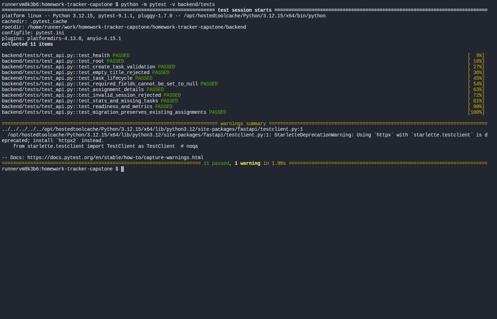

The isolated Compose project started from an empty volume, rebuilt both application images and reached healthy status for all three services.

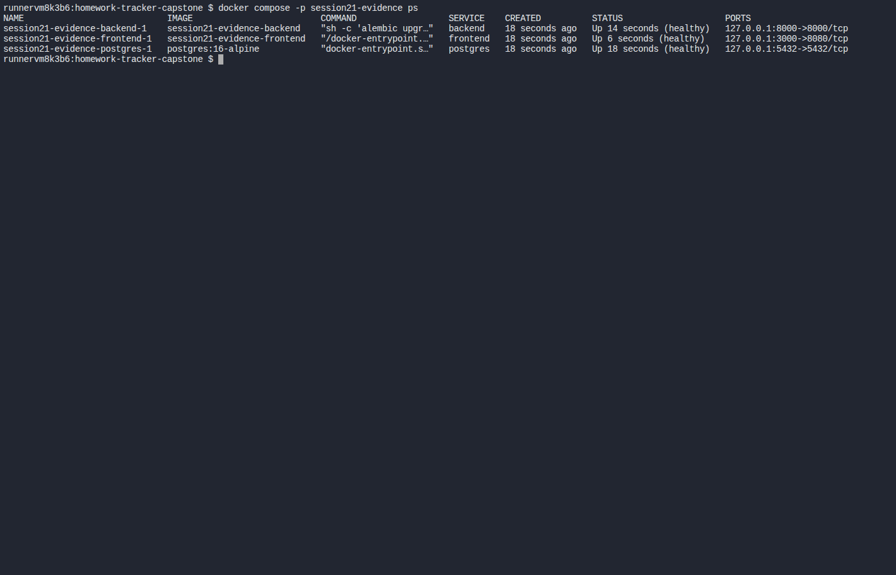

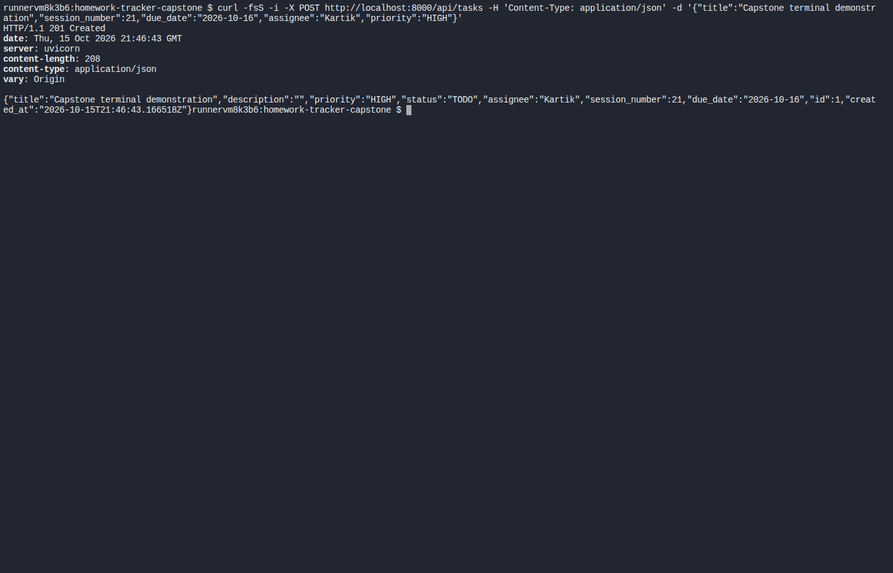

[Read/update response](../screenshots/terminal/api-read-update.txt) · [Statistics/delete response](../screenshots/terminal/api-stats-delete.txt) · [Exact commands and exit codes](../screenshots/terminal/compose-commands.json)

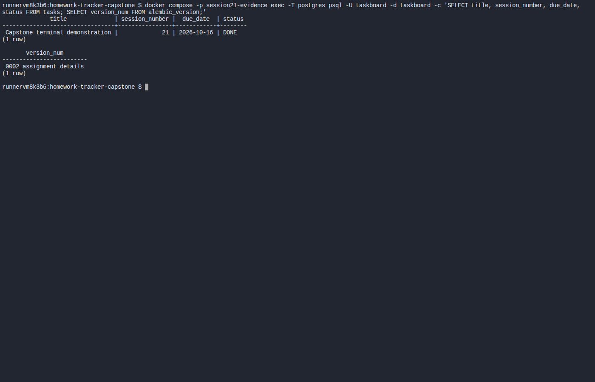

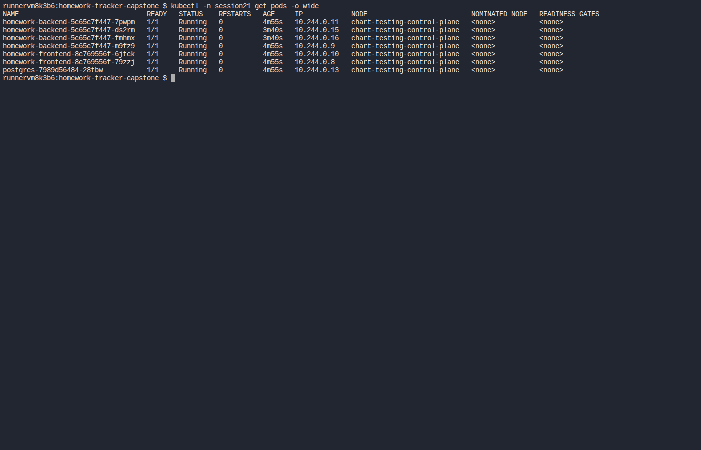

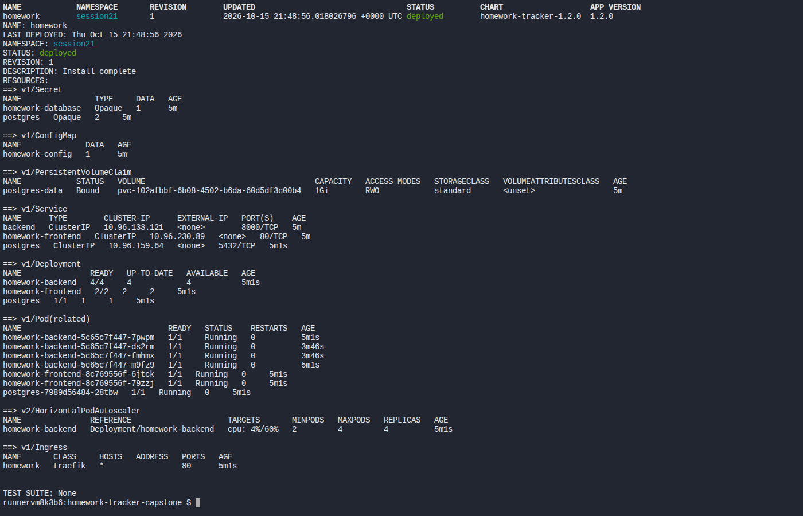

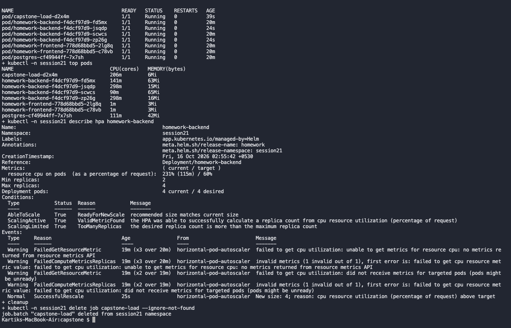

[HPA output](../screenshots/terminal/cloud-hpa-load.txt) shows two to four backend replicas under HTTP load. [CI GitOps state](../screenshots/verification/standalone-review-gitops.yaml) is Synced/Healthy after restoring a changed replica count. The rehearsal used the previous approved bootstrap image; the committed values now promote the standalone release.

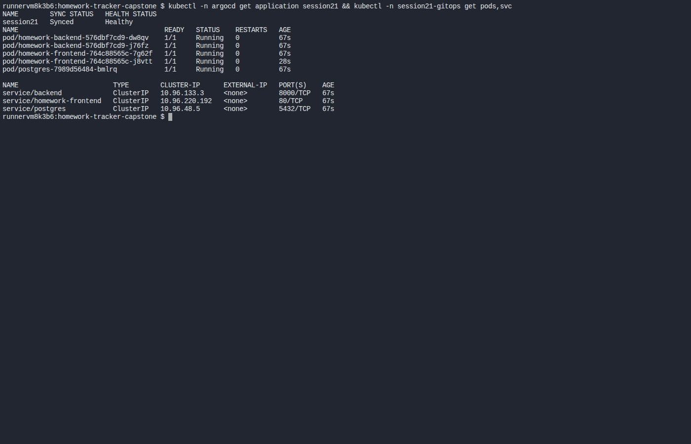

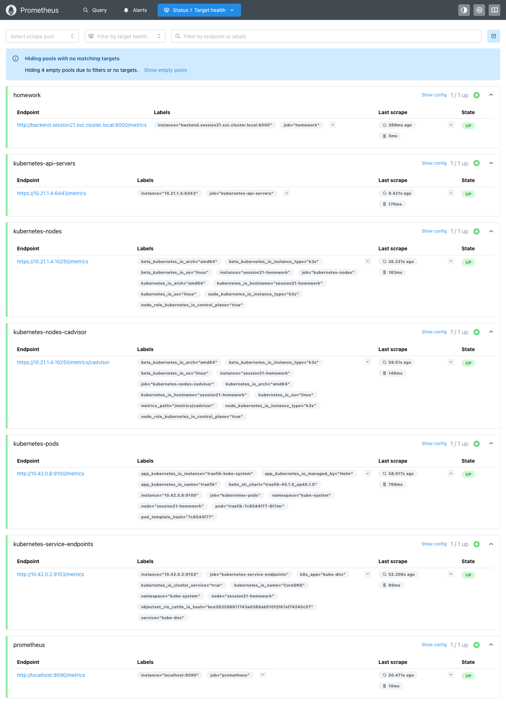

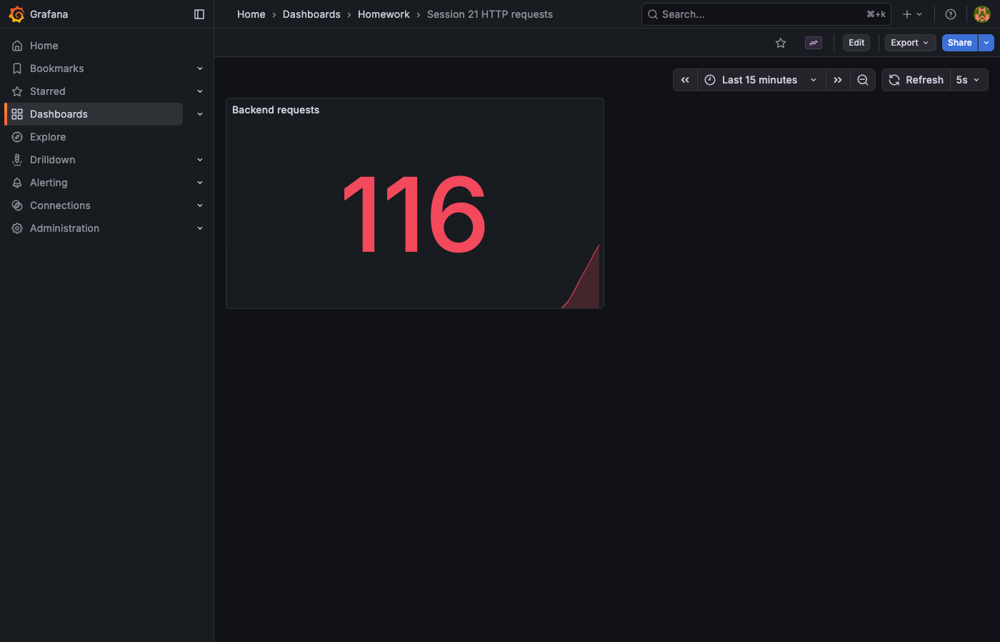

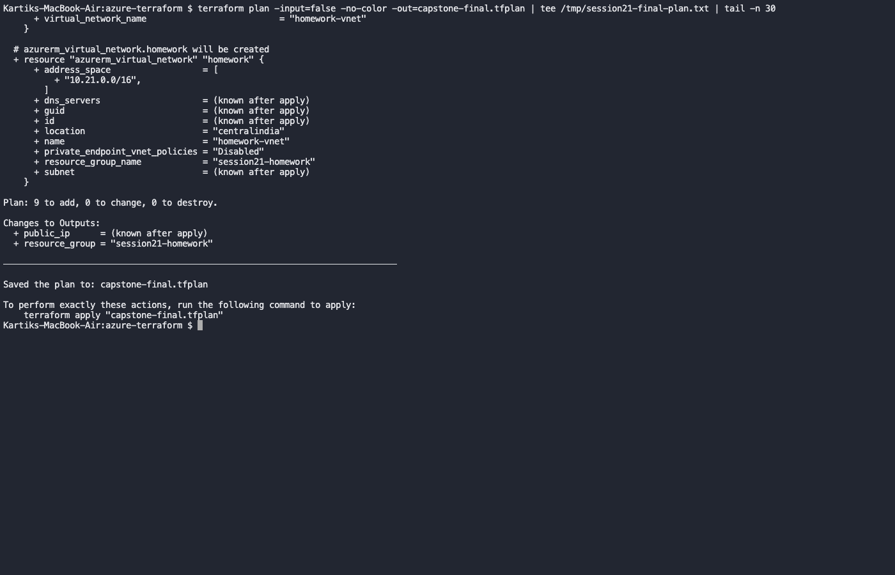

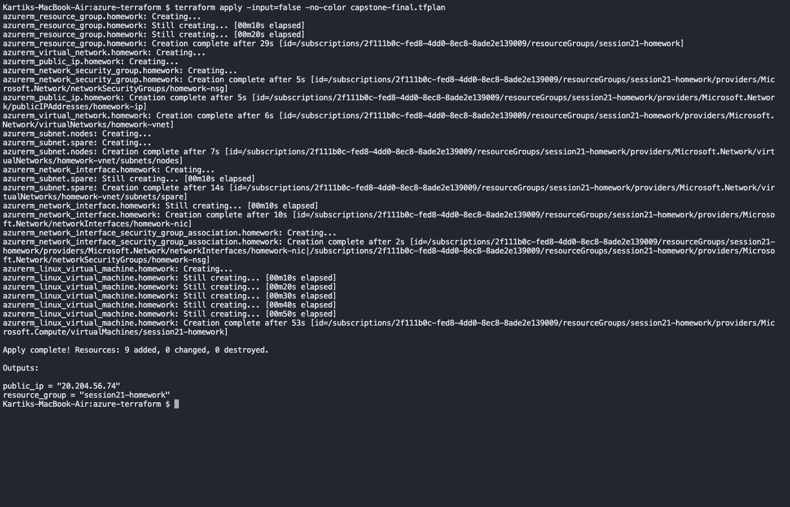

[Azure upgrade and PostgreSQL persistence](../screenshots/terminal/cloud-api-after.txt) · [Recorded failure and recovery commands](../screenshots/terminal/cloud-troubleshooting.txt) · [First standalone Service timeout](../screenshots/terminal/service-check-first-attempt.txt)

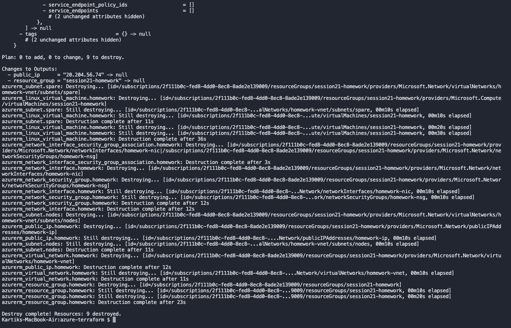

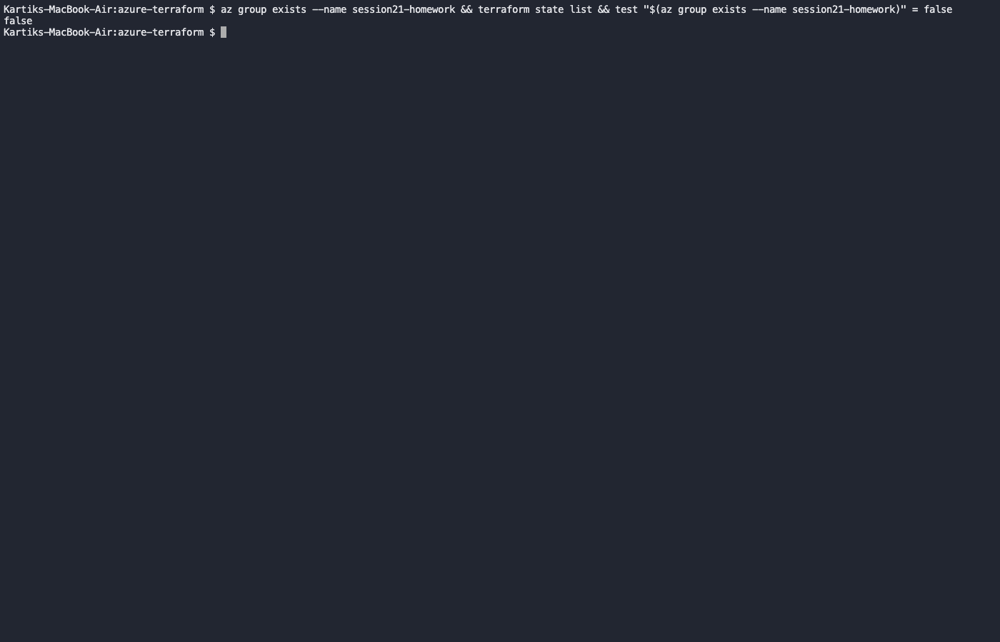

Terraform destroyed all nine resources. Azure returned `false` for the resource-group existence check; the SSH tunnel and monitoring forwards have stopped. The cloud URL is no longer hosted.

[Recorded walkthrough and chapters](walkthrough.md) · [Video](../screenshots/capstone-walkthrough.mp4) · [Image archive checksum](../screenshots/verification/release-images.json) · [Pipeline metadata](../screenshots/verification/standalone-ci-run.json)
